# Hello Polly 🦜

English words for a child who cannot read yet. Every word is a picture: tap it and hear it,
slowly 🐢 or at normal speed 🐇. Polly the pirate parrot speaks every instruction in Polish,
short games reuse the words already learned, and a full star meter opens a treasure chest of
stickers for an album. Two parents can share one family, so either phone continues the same
children's progress.

It runs in the browser and installs as a PWA on a phone, tablet or computer. The interface is in
**Polish**; the only English the child hears is the vocabulary itself (CEFR A1 / Cambridge
Pre A1 Starters). The code, comments and documentation are in English.

> **Status: in development. Phases 1–8 of 11 are done**: the scaffold, the content and the
> local data layer, speech, children and the word plan, real lessons, rewards, Drive sync, and
> inviting the second parent. A parent sets up a
> child (nickname and an animal picture), chooses the topics and, if they like, the exact words
> to start with. The child gets a treasure map of islands: each island is a lesson of about
> 8–12 steps, up to three new words in *look and listen*, then „Gdzie jest…?” picks with 2–4
> pictures that mix the new words with reviews. A wrong tap only wiggles and says the word again;
> after the second miss the right picture glows. Stars appear at the end of each island. Once a
> child has learned four words, a game shelf opens with three games: *Posłuchaj i dotknij*,
> *Cyferki* (tap a digit, hear a word, find its picture) and *Memory*. The parent panel sits
> behind a parent gate (a number in Polish words). Stars fill a meter on the map; a full meter
> brings a treasure chest that opens in three taps and gives 1–3 stickers for an album, one
> sticker per word (rare gold ones shimmer), each saying its English word when tapped. A
> parent can save the family in one file on their own Google Drive (*Rodzina*), and every
> device signed in to that account then continues the same children's progress; the child
> never sees sign-in or sync. From *Rodzina* that parent invites the other by e-mail: the
> other parent opens the link, signs in with their own Google account, picks the family file
> in Google's file picker, and both phones then share the same children, settings and
> progress. The owner of the file can remove the other parent again. Stories, screen time and
> the progress dashboard come in later phases. The development build is live at
> https://hellopolly.gorny.dev (v0.1.0, from before Drive sync).
> [STATE.md](STATE.md) records what was decided and what is still open.

## What it looks like (so far)

| Treasure map (child) | Look and listen (child) | Listen and tap (child) |
|---|---|---|
| 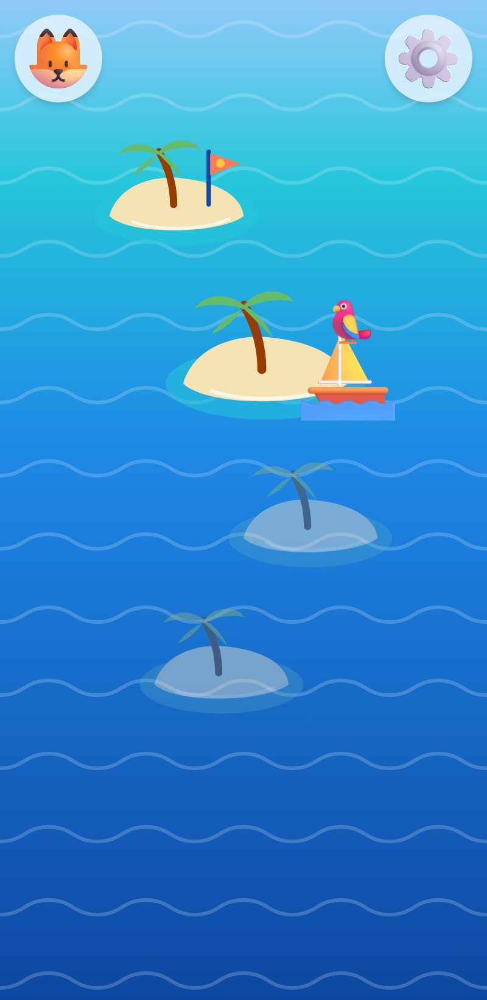 | 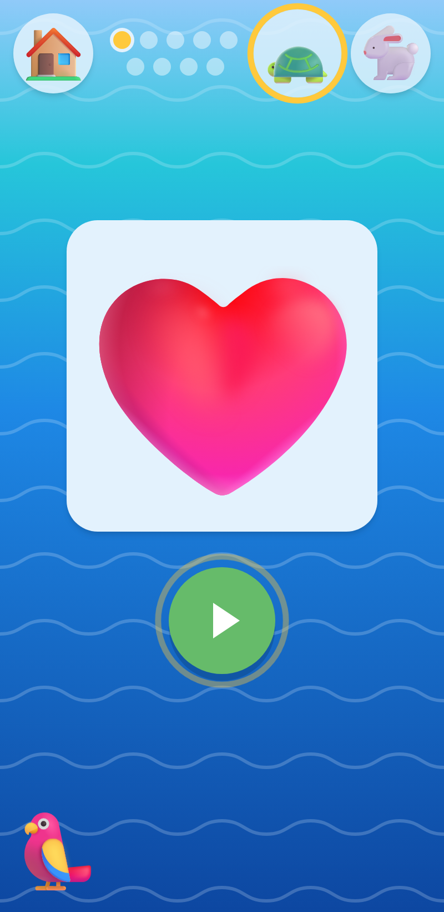 | 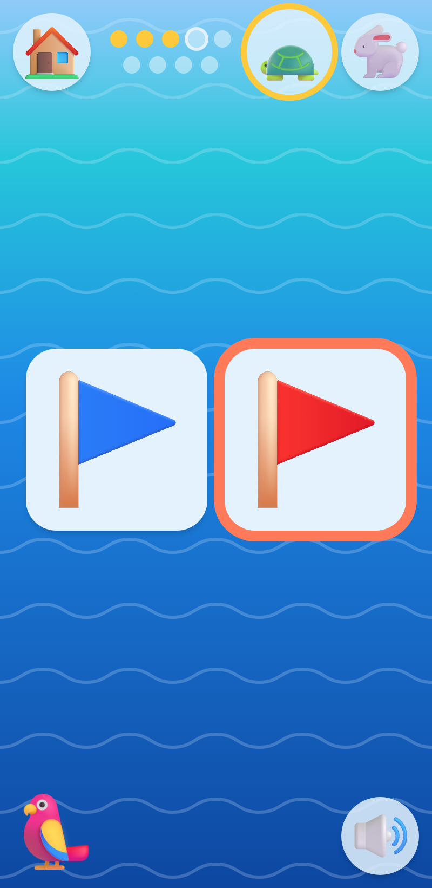 |
| **Cyferki (child)** | **Island won (child)** | **Start (child)** |
| 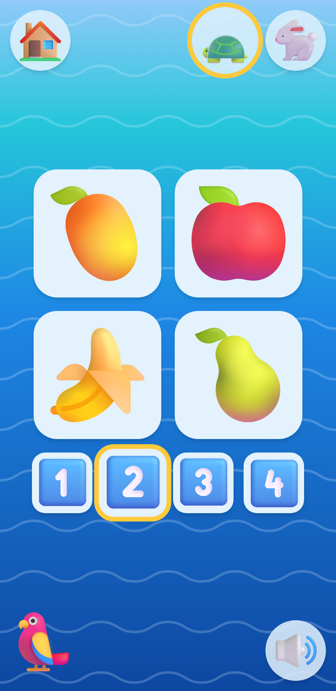 | 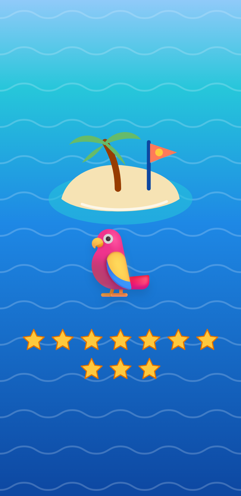 | 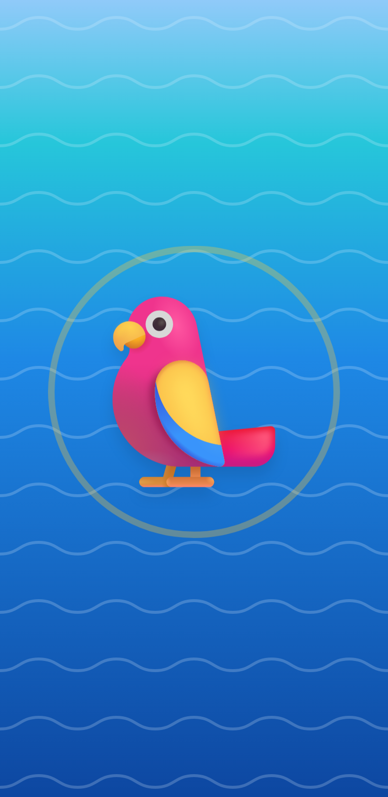 |
| **Treasure chest (child)** | **Sticker album (child)** | |
| 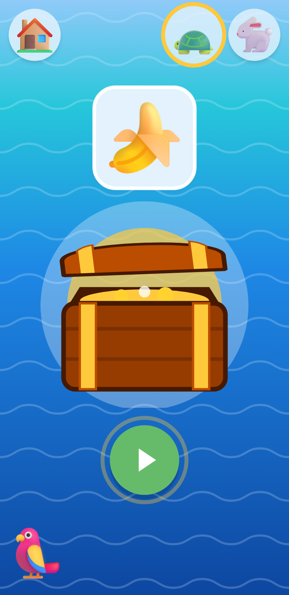 | 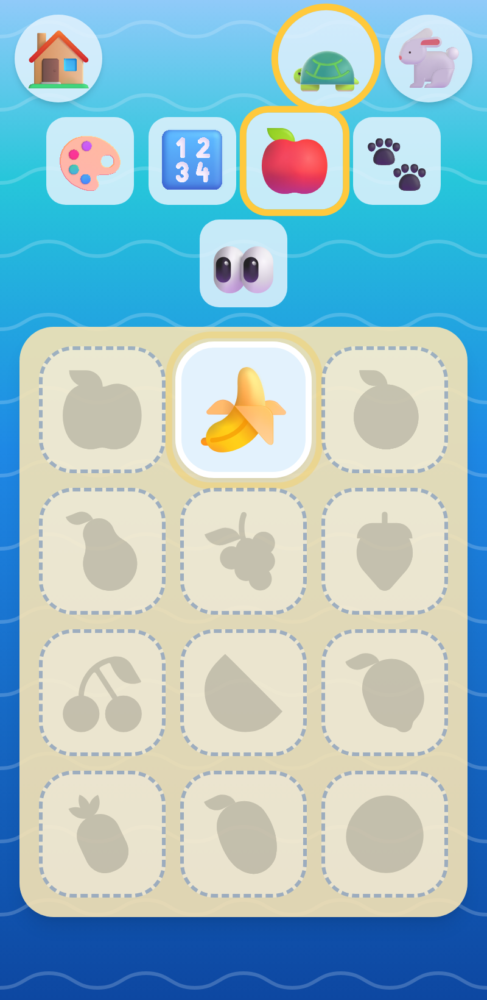 | |
| **Parent gate** | **Word plan (parent)** | **Speech and voices (parent)** |
| 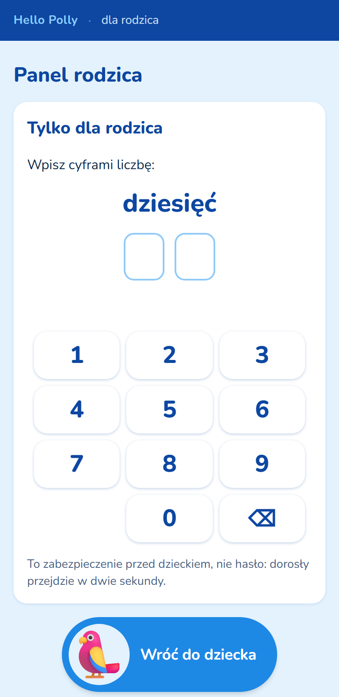 | 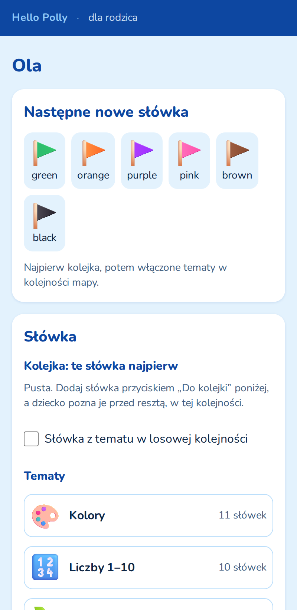 | 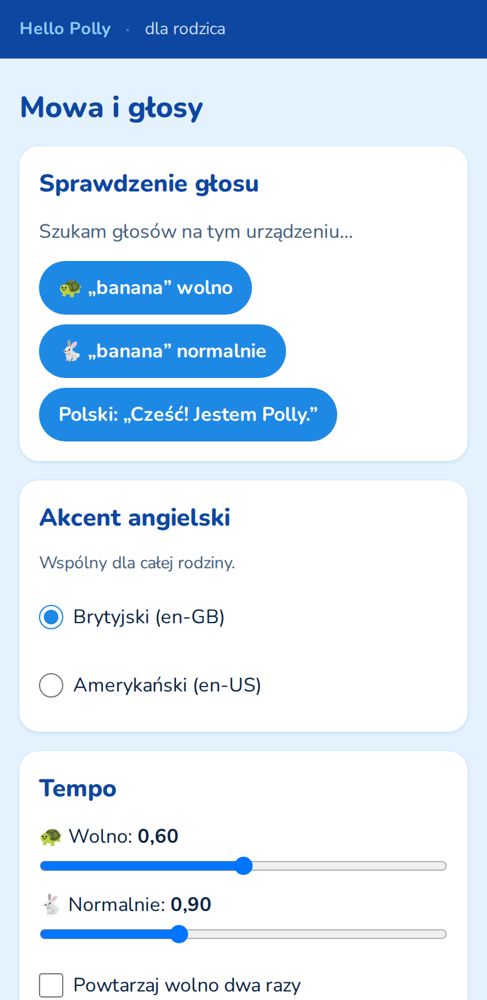 |

## What it will and will not do

- **No reading needed.** Instructions are spoken by the device's Polish voice and shown with
  icons and animation; tap targets are at least 72 px.
- **No loss mechanics.** No hearts, no streak to lose, no timers, no red ✗. A wrong tap gets a
  gentle wiggle, the word again, and after the second miss the right picture glows.
- **No speech recognition, no recording.** The microphone and the camera are denied by the
  page's own `Permissions-Policy`.
- **No backend and no secrets.** Progress lives in the browser and, if a parent connects it, in
  one file in that parent's own Google Drive. Speech is the device's own voice; nothing is
  uploaded and no audio file is shipped.
- **No ads, no purchases.**

## How it is built

A pure client-side SPA: Vite, Svelte 5, TypeScript (strict), Tailwind CSS v4, hash routing.
IndexedDB is the source of truth; Google Drive is an optional sync layer. The static bundle is
built in CI and served by Caddy in Docker behind nginx and Cloudflare, with a strict CSP (no
`unsafe-inline`, no `unsafe-eval`). Pictures are Microsoft Fluent Emoji, served from jsDelivr
at the release tag.

- Development setup and cross-platform rules: [docs/DEVELOPMENT.md](docs/DEVELOPMENT.md)
- Deployment, secrets, rollback: [docs/DEPLOYMENT.md](docs/DEPLOYMENT.md)
- Security policy: [SECURITY.md](SECURITY.md)
- Release notes: [CHANGELOG.md](CHANGELOG.md)

```bash
npm ci
npm run dev          # http://localhost:5173 (no CSP)
npm run docker:up    # http://localhost:8081 (production headers)
```

## Licence

[MIT](LICENSE). The Nunito font is under the SIL Open Font License 1.1
([src/assets/fonts/OFL.txt](src/assets/fonts/OFL.txt)). The pictures are Microsoft Fluent
Emoji, MIT ([content/img/LICENSE](content/img/LICENSE),
[attribution](content/img/ATTRIBUTION.md)).
